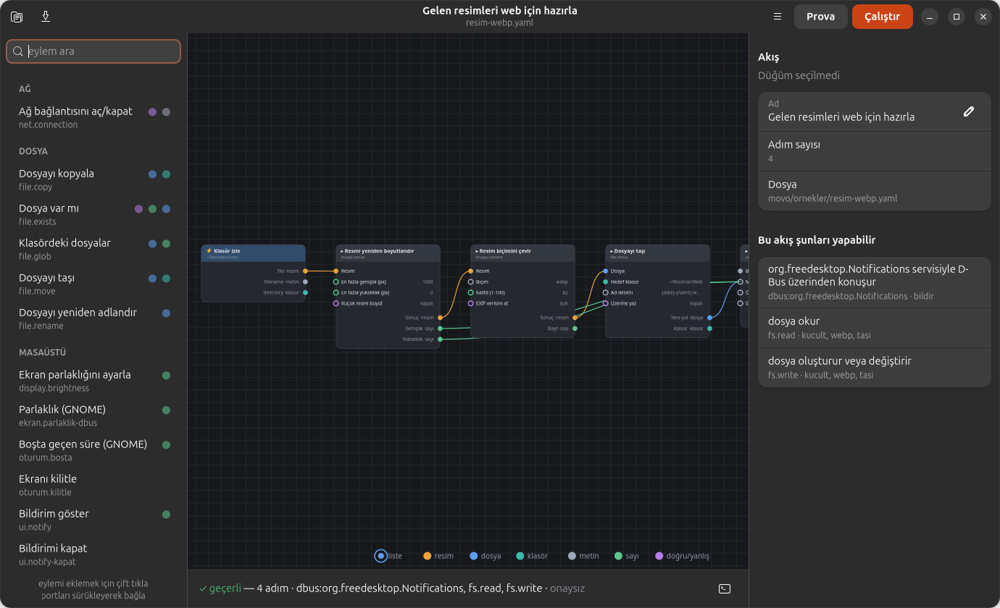
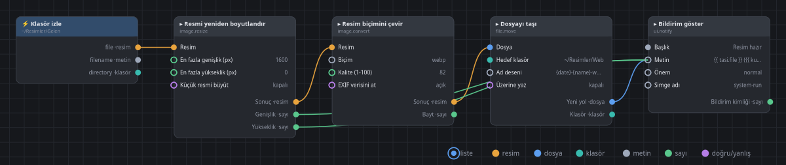
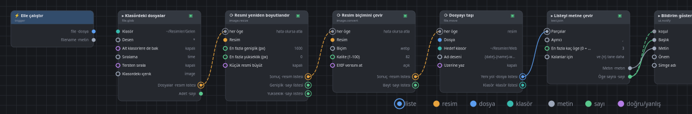
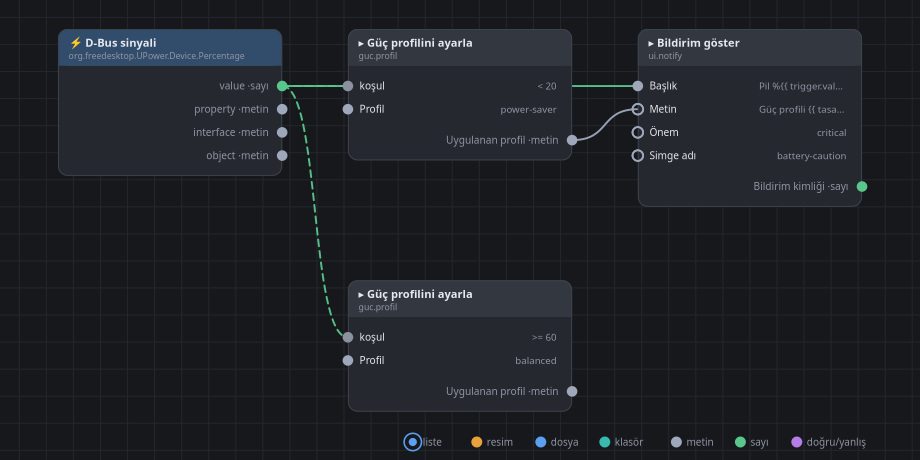
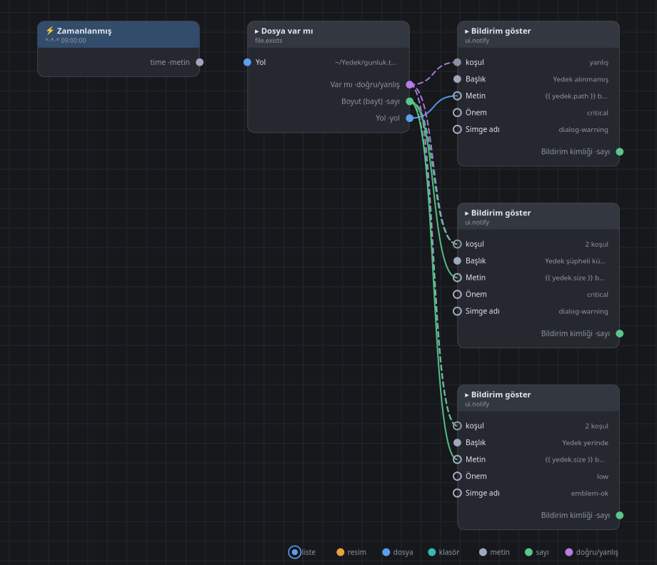

<div align="center">


# Movo Automation

**A visual automation engine for Linux.**

English · [Türkçe](README.tr.md)

</div>

Movo Automation lets you automate file operations and system events without
writing scripts. You build a flow out of blocks that snap together, and the
engine takes care of the rest: it validates the flow before it runs,
compiles it into systemd units so it keeps working in the background, and
talks to desktop applications over D-Bus.

The idea comes from Shortcuts and Automator on macOS. What makes those work
is not the triggers — Linux already has inotify, systemd timers and
NetworkManager events. What is missing is a shared vocabulary of actions and
a type system that keeps the blocks compatible. Movo Automation provides
both, and puts a node editor on top.



## How it works

### Actions are declared, not hard-coded

Every action describes itself in a small manifest file: what it is called,
what it takes in, what it gives back, and which capabilities it needs.

```yaml
id: image.resize
name: Resmi yeniden boyutlandır
permissions: [fs.read, fs.write]
inputs:
  image: {type: image, required: true}
  max_width: {type: number, default: 1600}
outputs:
  image: {type: image}
```

Dropping such a file into `~/.local/share/movo/actions/` is enough for the
action to show up in the editor's palette — the automation counterpart of
what `.desktop` files do for the application menu. Movo ships 23 actions for
files, images, text, the desktop and D-Bus.

### Types keep the blocks compatible

Every port has a type: `text`, `number`, `file`, `image`, `directory`,
`list<file>` and so on. The connection between two blocks is only allowed
when the types fit. An image fits where a file is expected, not the other
way round.

This is what you see on the canvas: while you drag a wire, only the ports
that can accept it light up. An invalid connection is refused before it is
drawn, and a flow with a type error does not run at all — it is reported
first:

```
hata  kucult.image: {{ trigger.filename }} bir metin veriyor,
      bu port resim bekliyor
```

### A flow is a readable file

The canvas and the text are two views of the same thing. Node positions
live under a separate key the engine ignores, so a flow written by hand
opens in the editor, and a flow saved from the editor runs from the command
line unchanged.

```yaml
name: Gelen resimleri web için hazırla
trigger:
  type: folder
  path: ~/Resimler/Gelen
  match: "*.{png,jpg,jpeg}"
steps:
  - id: kucult
    action: image.resize
    with: {image: "{{ trigger.file }}", max_width: 1600}
  - id: webp
    action: image.convert
    with: {image: "{{ kucult.image }}", format: webp}
  - id: tasi
    action: file.move
    with:
      file: "{{ webp.image }}"
      to_dir: ~/Resimler/Web
      pattern: "{date}-{name}-web.{ext}"
```

`{{ step.output }}` is the wire between two nodes, written out.

### Triggers decide when it runs

| trigger | runs when |
|---|---|
| folder | a file appears in a watched folder (inotify) |
| schedule | a given time arrives (systemd timer) |
| network | a connection goes up or down |
| D-Bus | a signal fires or a property changes |
| manual | you run it yourself |

A flow can wait for a battery level to drop, a USB drive to be mounted, or
a screenshot to land in a folder. Installing it writes the matching systemd
user units, so it keeps working after a reboot.

### Flows can branch, loop and recover

A step can carry a condition, run once per item of a list, work on several
items at the same time, or hand its error to another step instead of
stopping the flow.

```yaml
  - id: kucult
    action: image.resize
    for_each: "{{ bul.files }}"     # once per file
    workers: auto                   # in parallel
    on_error: atla                  # a broken file does not stop the rest
    with: {image: "{{ item.value }}", max_width: 1600}
```

### Permissions are asked for, approved, and enforced

Each action declares what it needs. Before a flow can run in the
background, you see that list and approve it; if the flow later starts
asking for more, the approval goes stale and tells you what changed. And
with `isolate: true` the step runs under a kernel-level restriction
(Landlock), so an action cannot reach past what it declared — even if it
tries.

## Examples

Four flows that ship with Movo, each showing a different shape of
automation. The pictures are the actual editor canvas.

### A folder that prepares its own images

A file lands in a watched folder; it comes out resized, converted to WebP
and filed away under a dated name.



```yaml
trigger:
  type: folder
  path: ~/Resimler/Gelen
  match: "*.{png,jpg,jpeg}"
steps:
  - {id: kucult, action: image.resize,  with: {image: "{{ trigger.file }}", max_width: 1600}}
  - {id: webp,   action: image.convert, with: {image: "{{ kucult.image }}", format: webp}}
  - {id: tasi,   action: file.move,     with: {file: "{{ webp.image }}", to_dir: ~/Resimler/Web}}
```

### The same work over a whole folder, in parallel

`for_each` runs a step once per item and turns its output into a list.
`workers` processes several at a time; the order of the results does not
change. `on_error: atla` means one corrupt file does not stop the rest.



```yaml
  - id: kucult
    action: image.resize
    for_each: "{{ bul.files }}"
    workers: auto
    on_error: atla
    with: {image: "{{ item.value }}", max_width: 1600}
```

### Reacting to the system

This flow wakes when UPower reports a new battery percentage. Below 20% it
switches to the power-saver profile and says so; at 60% and above it goes
back to balanced. The dashed wires are conditions, not data.



```yaml
trigger:
  type: dbus
  bus: system
  interface: org.freedesktop.UPower.Device
  property: Percentage
  produces: number
steps:
  - id: tasarruf
    action: guc.profil
    when: {left: "{{ trigger.value }}", op: "<", right: 20}
    with: {profile: power-saver}
```

### Branching

One check, three outcomes — the backup is missing, suspiciously small, or
fine. Exactly one of them speaks, because a step whose condition fails is
skipped, and so is anything depending on it.



```yaml
  - id: yok
    action: ui.notify
    when: {left: "{{ yedek.exists }}", op: yanlış}
    with: {title: Yedek alınmamış}

  - id: kucuk
    action: ui.notify
    when:
      - {left: "{{ yedek.exists }}", op: doğru}
      - {left: "{{ yedek.size }}", op: "<", right: 1048576}
    with: {title: Yedek şüpheli küçük}
```

## Installation

Download a package from the
[Releases](https://github.com/M-SukruSezer/MovoAutomation/releases) page:

```sh
sudo apt install ./movo_0.1.0_all.deb        # Debian, Ubuntu, Mint…
sudo dnf install ./movo-0.1.0-1.noarch.rpm   # Fedora, RHEL, openSUSE…
```

Or from source:

```sh
tar xf movo-0.1.0.tar.gz && cd movo-0.1.0
pip install .
```

The engine itself needs only Python 3.10+ and PyYAML. Image actions use
Pillow. The editor and the D-Bus actions need GTK 4 and libadwaita:

```sh
sudo apt install python3-gi gir1.2-gtk-4.0 gir1.2-adw-1
```

After installing, `movo surum` reports what is present and what is missing,
and `movo masaustu` adds the editor to the application menu.

## Using it

```sh
movo duzenle                 # open the editor
movo eylemler                # list available actions
movo akislar                 # list flows
movo kontrol <flow>          # validate without running
movo calistir <flow>         # run once
movo kur <flow>              # install as a systemd unit
```

The command line and the action names are Turkish; both READMEs describe
the same commands.

## License

MIT. See [LICENSE](LICENSE).
