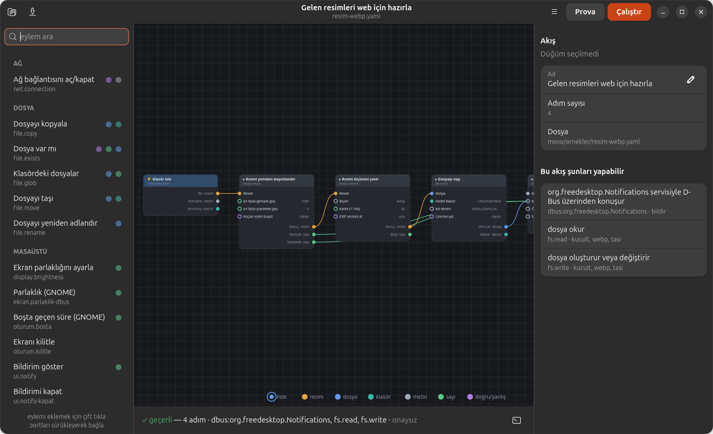
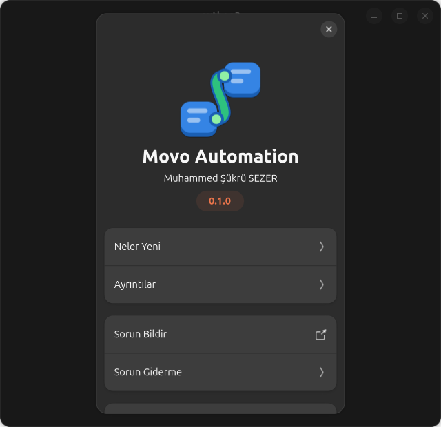

<div align="center">


# Movo Automation

**Linux için görsel otomasyon motoru.**

[English](README.md) · Türkçe

</div>

Movo Automation, dosya işlemlerini ve sistem olaylarını betik yazmadan
otomatikleştirmenizi sağlar. Birbirine takılan bloklardan bir akış
kurarsınız, gerisini motor halleder: akışı çalışmadan önce doğrular,
systemd birimlerine derleyerek arka planda sürmesini sağlar ve masaüstü
uygulamalarıyla D-Bus üzerinden konuşur.

Fikir macOS'taki Kestirmeler ve Automator'dan geliyor. Onları mümkün kılan
şey tetikleyiciler değil — Linux'ta inotify, systemd zamanlayıcıları ve
NetworkManager olayları zaten var. Eksik olan, ortak bir eylem sözlüğü ve
blokların uyumunu koruyan bir tip sistemi. Movo Automation ikisini de
sağlıyor ve üstüne bir düğüm editörü koyuyor.



## Nasıl çalışır

### Eylemler koda gömülmez, beyan edilir

Her eylem kendini küçük bir manifest dosyasında tanıtır: adı ne, neyi
girdi alıyor, ne döndürüyor ve hangi yetkilere ihtiyacı var.

```yaml
id: image.resize
name: Resmi yeniden boyutlandır
permissions: [fs.read, fs.write]
inputs:
  image: {type: image, required: true}
  max_width: {type: number, default: 1600}
outputs:
  image: {type: image}
```

Böyle bir dosyayı `~/.local/share/movo/actions/` içine koymak, eylemin
editörün paletinde görünmesi için yeterli — `.desktop` dosyalarının
uygulama menüsü için yaptığı işin otomasyon karşılığı. Movo; dosya, resim,
metin, masaüstü ve D-Bus için 23 eylemle geliyor.

### Tipler blokların uyumunu korur

Her portun bir tipi var: `metin`, `sayı`, `dosya`, `resim`, `klasör`,
`dosya listesi` ve benzeri. İki blok arasındaki bağlantı ancak tipler
uyuyorsa kurulabiliyor. Resim, dosya beklenen yere takılıyor; tersi
takılmıyor.

Tuvalde gördüğünüz şey bu: kabloyu sürüklerken yalnızca onu kabul
edebilecek portlar parlıyor. Geçersiz bağlantı çizilmeden reddediliyor,
tip hatası olan akış ise hiç çalışmıyor — önce bildiriliyor:

```
hata  kucult.image: {{ trigger.filename }} bir metin veriyor,
      bu port resim bekliyor
```

### Akış okunabilir bir dosyadır

Tuval ile metin aynı şeyin iki görünümü. Düğüm konumları motorun
görmezden geldiği ayrı bir anahtarda duruyor; bu yüzden elle yazılmış bir
akış editörde açılıyor, editörde kaydedilen akış da komut satırından
olduğu gibi çalışıyor.

```yaml
name: Gelen resimleri web için hazırla
trigger:
  type: folder
  path: ~/Resimler/Gelen
  match: "*.{png,jpg,jpeg}"
steps:
  - id: kucult
    action: image.resize
    with: {image: "{{ trigger.file }}", max_width: 1600}
  - id: webp
    action: image.convert
    with: {image: "{{ kucult.image }}", format: webp}
  - id: tasi
    action: file.move
    with:
      file: "{{ webp.image }}"
      to_dir: ~/Resimler/Web
      pattern: "{date}-{name}-web.{ext}"
```

`{{ adim.cikti }}`, iki düğüm arasındaki kablonun yazıya dökülmüş hâli.

### Tetikleyiciler ne zaman çalışacağını belirler

| tetikleyici | ne zaman çalışır |
|---|---|
| klasör | izlenen klasöre dosya düştüğünde (inotify) |
| zaman | belirtilen saat geldiğinde (systemd timer) |
| ağ | bir bağlantı açıldığında ya da kapandığında |
| D-Bus | bir sinyal geldiğinde ya da özellik değiştiğinde |
| elle | siz çalıştırdığınızda |

Bir akış; pil seviyesinin düşmesini, USB belleğin takılmasını ya da klasöre
ekran görüntüsü düşmesini bekleyebilir. Kurduğunuzda gereken systemd
kullanıcı birimleri yazılır, yani yeniden başlatmadan sonra da çalışmaya
devam eder.

### Akışlar dallanır, döner, hatadan dönebilir

Bir adım koşul taşıyabilir, bir listenin her ögesi için ayrı çalışabilir,
birkaç ögeyi aynı anda işleyebilir ya da hatasını akışı durdurmak yerine
başka bir adıma devredebilir.

```yaml
  - id: kucult
    action: image.resize
    for_each: "{{ bul.files }}"     # her dosya için bir kez
    workers: auto                   # paralel olarak
    on_error: atla                  # bozuk bir dosya ötekileri durdurmasın
    with: {image: "{{ item.value }}", max_width: 1600}
```

### İzinler istenir, onaylanır ve zorlanır

Her eylem neye ihtiyacı olduğunu beyan eder. Bir akış arka planda
çalışmaya başlamadan önce bu listeyi görür ve onaylarsınız; akış sonradan
daha fazlasını istemeye başlarsa onay bayatlar ve neyin değiştiğini söyler.
`isolate: true` ile de adım, çekirdek düzeyinde bir kısıtlama (Landlock)
altında çalışır — yani eylem, beyan ettiğinin ötesine denemeye kalksa bile
uzanamaz.

## Hakkında

Editörün uygulama menüsünde bir Hakkında girdisi var: sürüm, proje
bağlantıları ve hata bildirimine ekleyebileceğiniz bir tanı raporu.



## Kurulum

[Sürümler](https://github.com/M-SukruSezer/MovoAutomation/releases)
sayfasından bir paket indirin:

```sh
sudo apt install ./movo_0.1.0_all.deb        # Debian, Ubuntu, Mint…
sudo dnf install ./movo-0.1.0-1.noarch.rpm   # Fedora, RHEL, openSUSE…
```

Ya da kaynaktan:

```sh
tar xf movo-0.1.0.tar.gz && cd movo-0.1.0
pip install .
```

Motorun kendisi yalnızca Python 3.10+ ve PyYAML ister. Resim eylemleri
Pillow kullanır. Editör ve D-Bus eylemleri için GTK 4 ve libadwaita gerekir:

```sh
sudo apt install python3-gi gir1.2-gtk-4.0 gir1.2-adw-1
```

Kurulumdan sonra `movo surum` neyin var neyin eksik olduğunu söyler,
`movo masaustu` ise editörü uygulama menüsüne ekler.

## Kullanım

```sh
movo duzenle                 # editörü aç
movo eylemler                # kullanılabilir eylemleri listele
movo akislar                 # akışları listele
movo kontrol <akış>          # çalıştırmadan doğrula
movo calistir <akış>         # bir kez çalıştır
movo kur <akış>              # systemd birimi olarak kur
```

## Lisans

MIT. Bkz. [LICENSE](LICENSE).
